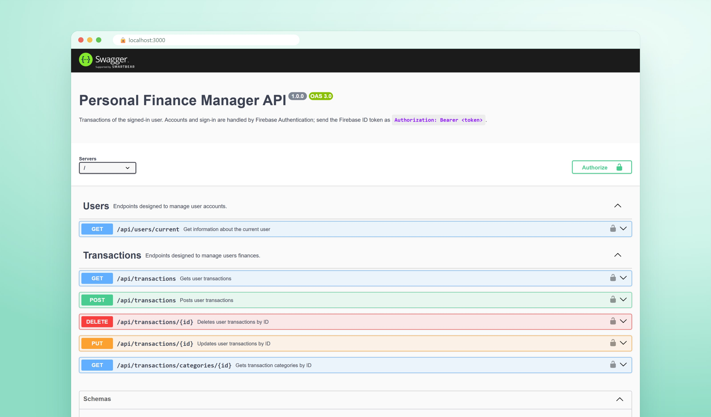
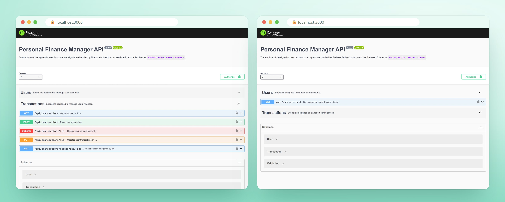

<p align="center">
  <picture>
    <source media="(prefers-color-scheme: dark)" srcset="docs/images/banner-dark.png">
    
  </picture>
</p>

<p align="center">
  
</p>

## About

**Personal Finance Manager API** is the REST API behind the
[Personal Finance Manager](https://github.com/DamTchorzewski/personal-finance-manager) web app. It checks the Firebase
sign-in of each request and stores each user's income and expense transactions in Firestore. It runs on Google Cloud Run.

- **Accounts.** Sign-up, sign-in (e-mail and password, or Google) and the verification e-mail are handled by Firebase
  Authentication. The API verifies the Firebase ID token of every request, and can require a confirmed e-mail address.
- **Transactions.** Create, list, update and delete the transactions of the signed-in user, newest first; each
  transaction has a type (`+` or `-`), a category, a date, a comment and a sum. Each user has their own collection
  (`users/{uid}/transactions`), so a user sees only their own.
- **Validation.** Request bodies are validated with Joi (unknown fields are dropped) and answered with one error
  format: `status`, `statusText` and `result.message`.
- **No secret to keep.** On Google Cloud the API runs as a service account, so there is no key and no database password;
  the deploy signs in to Google with Workload Identity Federation, so there is no key in GitHub either.
- **Documented.** Swagger UI at `/api-docs`, from `src/docs/swagger.json` (OpenAPI 3).

| Method and path                         | Auth | What it does                               |
| --------------------------------------- | :--: | ------------------------------------------ |
| `GET /health`                           |      | health check (does not touch Firestore)    |
| `GET /api/users/current`                | yes  | the signed-in user                         |
| `GET /api/transactions`                 | yes  | the user's transactions                    |
| `POST /api/transactions`                | yes  | add a transaction                          |
| `PUT /api/transactions/:id`             | yes  | update a transaction                       |
| `DELETE /api/transactions/:id`          | yes  | delete a transaction                       |
| `GET /api/transactions/categories/:id`  | yes  | the category of a transaction              |

> **Status:** there are no automated tests; the first request after a pause is slower (the service scales to zero).

## Tech stack

|          |                                                                                                   |
| -------- | ------------------------------------------------------------------------------------------------- |
| Stack    | Node.js 20 or newer (ES modules), Express 4                                                       |
| Data     | Firestore, through the Firebase Admin SDK                                                         |
| Auth     | Firebase Authentication (e-mail and password, Google); ID tokens verified with the Admin SDK     |
| Services | Joi for validation                                                                                |
| Docs     | Swagger UI (`swagger-ui-express`), OpenAPI 3                                                      |
| Tests    | none                                                                                              |
| Hosting  | Google Cloud Run, deployed from the source by GitHub Actions (`.github/workflows/deploy.yml`)     |

The messages, code and commits are in English.

## Screenshots

<p align="center">
  
</p>

The images are the Swagger UI served by the app itself (it needs no database). An API has no other screen, so there is
no phone view.

## Quick start

```bash
git clone https://github.com/DamTchorzewski/personal-finance-manager-api.git
cd personal-finance-manager-api
npm install
cp .env.example .env      # set FIREBASE_PROJECT_ID, see Configuration
npm run dev               # http://localhost:8080/api-docs
```

Requirements: Node.js 20 or newer, npm, and either a Firebase project or the Firebase emulators (Authentication and
Firestore). The deployment to Google Cloud is described in [docs/deployment.md](docs/deployment.md).

## Scripts

| Command            | What it does                                                         |
| ------------------ | -------------------------------------------------------------------- |
| `npm start`        | production server (`NODE_ENV=production`)                            |
| `npm run dev`      | development server with `nodemon`                                    |
| `npm run lint`     | ESLint over the sources                                              |
| `npm run lint:fix` | ESLint with automatic fixes                                          |

## Configuration

The file is `.env.example` (names only, copy it to `.env`). None of the variables is a secret.

| Variable                                          | What it is                                                                  |
| ------------------------------------------------- | --------------------------------------------------------------------------- |
| `FIREBASE_PROJECT_ID`                             | the Firebase / Google Cloud project (required)                              |
| `PORT`                                            | port the API listens on (optional, 8080; Cloud Run sets it)                 |
| `CORS_ORIGIN`                                     | web origins allowed to call the API, comma separated (optional, any origin) |
| `REQUIRE_VERIFIED_EMAIL`                          | `false` lets users in before they confirm their e-mail (optional)           |
| `GOOGLE_APPLICATION_CREDENTIALS`                  | a service account key file, only for local work against the real project   |
| `FIREBASE_AUTH_EMULATOR_HOST`, `FIRESTORE_EMULATOR_HOST` | the Firebase emulators, only for local work                          |

## Structure

```
src/server.js          ★ starts the app on PORT
src/app.js             Express app: Swagger UI, CORS, /health, the routers, the error handlers
src/routes/            users.js and transactions.js: the routes and their middleware
src/controllers/       request handling: validation, status codes, the response format
src/services/          the Firestore queries (users/{uid}/transactions)
src/middlewares/       auth.js: the Firebase ID token check
src/config/            firebase.js: the Firebase Admin app, Authentication and Firestore
src/utils/             validation (Joi), error helpers
src/docs/              swagger.json: the OpenAPI description
.github/workflows/     deploy.yml: deploy to Cloud Run from main
docs/                  deployment steps, repository description; docs/images/ holds the README images (generated)
```

## Branches and workflows

Shared standards from `reops/standards`: `main` ≤ `develop` ≤ a working branch `<type>/<topic>`, Conventional
Commits in English. `deploy.yml` deploys every push to `main` (not documentation-only ones). Details:
`reops/standards/git.md` and `reops/standards/workflows.md`.

**Departures from the standards (and why):**

- **No CI checks, no tests, no hooks:** a small back end; the checks are `npm run lint` and the Swagger UI.
- **Google actions pinned by version tag, not by commit:** `google-github-actions/auth` and `deploy-cloudrun` are
  referenced as `@v2`.
- **npm, not pnpm:** the project predates the standards.
- **README images** are made by `tools/readme-images` (profile `personal-finance-manager-api`) from the Swagger UI the
  app serves locally; the logo is a wordmark, and there is no "Open site" button and no phone strip.
- **No DamReboot footer:** not a company product.

## Documentation

| File                                     | What it covers                                                          |
| ---------------------------------------- | ----------------------------------------------------------------------- |
| [docs/deployment.md](docs/deployment.md) | Google Cloud, Firebase and GitHub setup, step by step, and the first deploy |
| [docs/repository.md](docs/repository.md) | GitHub description and topics, and the command that sets them           |

The README images (`docs/images/`) are regenerated with `tools/readme-images`, profile `personal-finance-manager-api`; the working shots go to `.scratch/`.

Author: [Damian Tchorzewski](https://github.com/DamTchorzewski). Licensed under the [MIT License](LICENSE).
